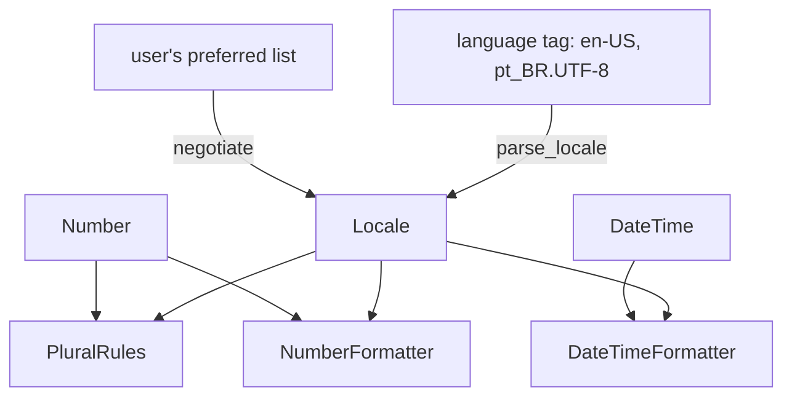

`dxn_intl` formats the three things apps localize most: plural forms, numbers and dates. You reach for it when text has to follow the user's language ("1 file", "2 files", "5 datoteka") and the same code has to print the same text in a native app, on a server and in WebAssembly.

## Install

The crate is not on crates.io. Releases are git tags (`vX.Y.Z`), so depend on a tag:

```bash
cargo add dxn_intl --git https://github.com/dXnSix/dXn.Intl --tag v0.1.0
```

or in `Cargo.toml`:

```toml
[dependencies]
dxn_intl = { git = "https://github.com/dXnSix/dXn.Intl", tag = "v0.1.0" }
```

`Cargo.lock` records the tagged commit. To upgrade, change the tag; see [Releases](./releasing.md). The crate has no Cargo features and needs Rust **1.97** or newer (the library is edition 2024, and CI checks 1.97).

The locale data is compiled into your binary, so there is nothing to download or ship next to it. There is no `docs.rs` page because the crate is not published; build the API reference with `cargo doc --open`.

## A first program

Every formatter is made from a `Locale`, which `parse_locale` reads from a language tag, plus the options for what it shows.

```rust
use dxn_intl::{
    DateTime, DateTimeFormatter, DateTimeOptions, IntlError, Length, NumberFormatter,
    NumberOptions, PluralKind, PluralRules, parse_locale,
};

fn main() -> Result<(), IntlError> {
    let locale = parse_locale("hr-HR")?;

    let plurals = PluralRules::new(&locale, PluralKind::Cardinal)?;
    println!("{}", plurals.category(23)); // few

    let money = NumberFormatter::new(&locale, NumberOptions::currency("EUR"))?;
    println!("{}", money.format(1234.5)?); // 1.234,50 €

    let dates = DateTimeFormatter::new(&locale, DateTimeOptions::date(Length::Long))?;
    println!("{}", dates.format(&DateTime::date(2026, 10, 27)?)?); // 27. listopada 2026.
    Ok(())
}
```

```text
few
1.234,50 €
27. listopada 2026.
```

:::warning The spaces are not ASCII spaces
CLDR separates a currency symbol, a percent sign or a thousands group with a non-breaking space (U+00A0) or a narrow no-break space (U+202F), and `en-US` times read `3:45 PM` with U+202F before `PM`. Compare formatted text against `"1.234,50\u{a0}€"`, not `"1.234,50 €"`. [Testing your output](./cookbook.md#test-formatted-text) shows a helper.
:::

The snippets in these docs use `?` and are meant to run inside a function that returns `Result<_, IntlError>` (or `Result<_, Box<dyn std::error::Error>>`: `IntlError` implements `std::error::Error`). Output shown in `assert_eq!` was produced by running the snippet.

## How the pieces fit



A formatter is built once for a locale and reused. `Number` and `DateTime` are plain values: a `Number` goes to the plural rules and the number formatter, a `DateTime` to the date formatter.

## What to reach for

| You need | Use | Page |
|---|---|---|
| A locale from a tag, `LANG` or `Accept-Language` | `parse_locale`, `negotiate` | [Locales](./locales.md) |
| "1 item" or "2 items" | `PluralRules::category` | [Plurals](./plurals.md) |
| "1st", "2nd", "3rd" | `PluralRules` with `PluralKind::Ordinal` | [Plurals](./plurals.md#ordinals) |
| `1,234.5`, `25%`, `$1,234.50` | `NumberFormatter` with `NumberOptions` | [Numbers](./numbers.md) |
| The number as it will be shown | `NumberFormatter::resolve` | [Numbers](./numbers.md#resolve) |
| `Oct 27, 2026`, `15:45` | `DateTimeFormatter` with `DateTimeOptions` | [Dates and times](./dates-and-times.md) |
| The wall time of a Unix timestamp | `DateTime::from_unix_millis` | [Dates and times](./dates-and-times.md#from-an-instant-to-a-wall-time) |
| Left to right or right to left | `direction` | [Locales](./locales.md#writing-direction) |

## Things to know early

- **Formatters are not `Send` or `Sync`.** `PluralRules`, `NumberFormatter` and `DateTimeFormatter` hold ICU4X data behind `Rc`, so they stay on the thread that made them. `Number`, `DateTime`, `Locale` and `IntlError` are `Send + Sync`. See [Platforms](./platforms.md#threads).
- **Floats lose trailing zeros.** `1.0_f64` becomes the number `1`. Parse text (`"1.0".parse::<Number>()`) or format with fixed fraction digits when the digits matter. See [Numbers](./numbers.md#number).
- **No clock, no time zones.** You pass the wall time. See [Dates and times](./dates-and-times.md#time-zones).
- **It is a 0.x library.** A minor release can break the API; read the release notes before bumping.

## Next

[Locales](./locales.md) covers reading tags and choosing the locale to format for. [Plurals](./plurals.md) is the page to read if you only need "1 item, 2 items".
